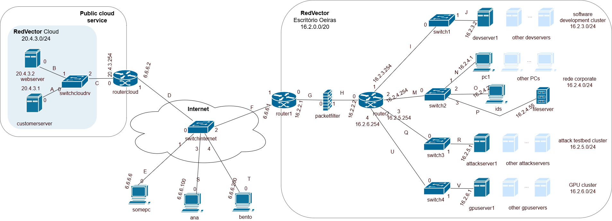

# 🔐 RedVector — securing a company network (Kathará lab)

> **TL;DR:** We secured the IT infrastructure of a fictional company, **RedVector**, in a virtual network of ~20 machines (routers, switches, servers, PCs). Remote employees connect through an encrypted **VPN** (OpenVPN, AES-128-GCM), sensitive servers sit in **isolated network segments** reachable only by **SSH with keys**, two **firewalls** (iptables) enforce a "deny everything not explicitly allowed" policy, and an **intrusion detection system** (Snort) raises alerts on suspicious traffic. University project for *Network and Computer Security* at Instituto Superior Técnico.

---

## What is this, in plain words?

Companies split their network into zones and control what can talk to what. If an attacker gets into one PC, they should **not** automatically reach the servers with sensitive data. This is called **network segmentation** (or micro-segmentation when the zones are small).

Instead of real hardware, the whole company runs as containers in **[Kathará](https://www.kathara.org/)**, a network emulator: each machine is a small Linux container and `lab.conf` says how they are wired.



## The network

| Zone | Addresses | What is there |
|---|---|---|
| **Cloud** | `20.4.3.0/24` | Public **web server** (Apache, company page) and a customer server |
| **Internet** | `6.6.6.0/24` | Outside world, including the PCs of remote employees **Ana** and **Bento** |
| **Corporate LAN** (office in Oeiras, `16.2.0.0/20`) | `16.2.4.0/24` | Employee PCs, file server, IDS |
| **Isolated clusters** | `16.2.3.0/24`, `16.2.5.0/24`, `16.2.6.0/24` | Software development (`devserver1`), attack testbed (`attackserver1`) and GPU cluster (`gpuserver1`) |
| **VPN** | `10.8.0.0/24` | Addresses given to remote employees when connected |

## What we configured

1. **VPN (OpenVPN):** `router1` is the VPN server; Ana and Bento are clients. We built a small certificate authority (CA) for RedVector with easy-rsa, issued certificates per user, used **AES-128-GCM** and `tls-auth`. Once connected, remote employees can reach the corporate LAN as if they were in the office.
2. **SSH with public-key authentication:** the isolated servers accept SSH only with keys (no passwords) and only from the allowed machines.
3. **Firewalls (iptables)** on `packetfilter` and `router2`, with the rules split by role to avoid redundancy:
   - default policy **DROP**: everything not explicitly allowed is blocked;
   - `ping` and `traceroute` allowed everywhere (for troubleshooting);
   - anyone can reach the public web server (HTTP);
   - isolated servers only talk to the machines they need;
   - **anti-spoofing**: packets with forged source addresses are dropped when entering or leaving the office;
   - **broadcast** addresses (`.255`) are blocked.
4. **Intrusion detection (Snort):** a custom Kathará image with Snort on the `ids` machine, with rules that alert on SSH and Telnet attempts to the corporate network and on possible **brute-force** attacks (5+ connections in 60 s from the same source).

## How to run it

You need **[Kathará](https://www.kathara.org/)** and Docker.

```bash
cd kathara-lab

# 1. Build the Snort image used by the IDS machine
docker build -t kathara/snort -f Dockerfile.snort .

# 2. Start the whole network
kathara lstart

# 3. Open a terminal on any machine, e.g.
kathara connect pc1
```

> **Keys and certificates are not included.** VPN certificates and keys (`ca.crt`, `<user>.crt`, `<user>.key`, `ta.key`) and the SSH private key were removed before publishing. To run the VPN and SSH parts, generate new ones (easy-rsa for OpenVPN, `ssh-keygen` for SSH) and place them in `shared/vpn-ana/`, `shared/vpn-bento/` and `pc1/home/sirs/.ssh/`. The step-by-step commands are in the report.

## Files

```
kathara-lab/          # The full lab: lab.conf + one .startup script and folder per machine
  router1/etc/openvpn/server.conf   # VPN server
  ids/etc/snort/                    # Snort config and custom rules
  packetfilter.startup, router2.startup   # Firewall rules
network-diagram.png   # Network map with our addresses
report/report.pdf     # Report with every command and test (in Portuguese)
```

## Authors

Vasco Caetano and group colleagues, Instituto Superior Técnico.

## Context

- **Course:** Network and Computer Security (Segurança Informática em Redes e Sistemas), Instituto Superior Técnico, University of Lisbon
- **Stack:** Linux, Kathará, OpenVPN, OpenSSH, iptables, Snort, Apache
- The base network topology was provided by the course teaching staff.
